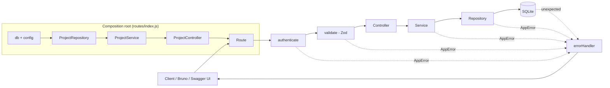
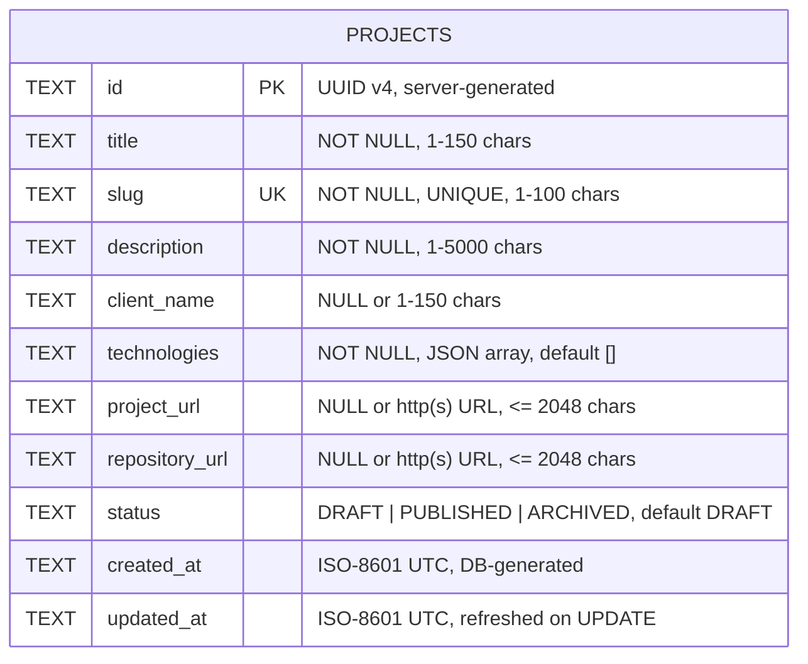
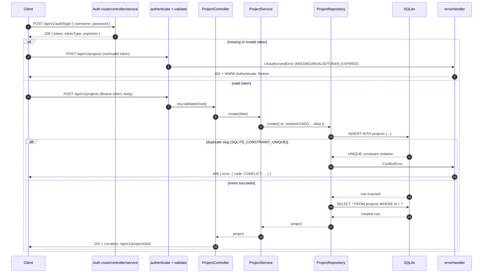
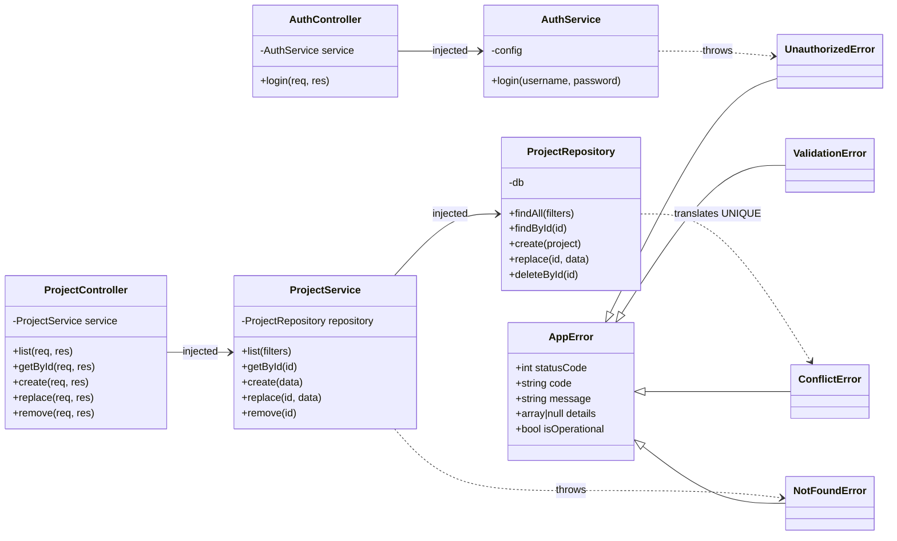

# COYS — Studio Portfolio API

REST API that manages the portfolio projects of a software studio. It is the backend
(headless CMS) that feeds the studio website. The project is built as a university final
project with a Quality Assurance role: the API behavior is documented by OpenAPI and
verified by a Bruno contract suite.

**Stack:** Node.js 20+ · Express 5 · plain JavaScript (ES Modules) · SQLite via
`better-sqlite3` · Zod · JWT (`jsonwebtoken`) · OpenAPI 3.0.3 + Swagger UI.

## Requirements

- Node.js 20 or newer (developed and verified with Node 20.20.2)
- npm

## Install and run

```bash
cd server
npm install
cp .env.example .env        # Windows PowerShell: Copy-Item .env.example .env
npm run db:reset
npm run dev
```

Before starting, replace `JWT_SECRET` (32+ characters) and `API_PASSWORD` in
`server/.env`. `npm start` runs the server without auto-reload.

- API: <http://localhost:3000>
- Liveness: `GET /health` → `200 {"status":"ok"}`
- Swagger UI / OpenAPI: <http://localhost:3000/api-docs>
- All `/api/v1` endpoints except `POST /api/v1/auth/login` require
  `Authorization: Bearer <token>`.

## Database commands (run from `server/`)

| Command | What it does |
|---|---|
| `npm run db:reset` | Delete the database, apply every migration, load `dev-data.sql` (5 rows) |
| `npm run db:reset -- --empty` | Same, but skip the seed (0 rows) |
| `npm run db:seed:edge` | Add the edge-case rows on top of the current data |
| `npm run db:break` | Drop the `projects` table to provoke a 500 (repair with `db:reset`) |

## Bruno contract suite

The Bruno collection lives in `api-tests/`. It is the contract suite for the 24 required
status-code cases plus extra robustness/edge cases. Run it from the repository root with
two terminals: **A** for the server, **B** for the tests.

> **Copy-paste warning.** Never type `<from .env>` or `<signed -1s>` literally: those are
> descriptions, not values. The block below computes every value from `server/.env`. A
> literal placeholder makes `00-login` return `401 INVALID_CREDENTIALS`, and every
> protected case then cascades to `401 INVALID_TOKEN`.

Setup once per shell in terminal B (repository root):

```powershell
$creds = @{}
Get-Content server/.env | ForEach-Object { if ($_ -match '^([A-Z_]+)=(.*)$') { $creds[$matches[1]] = $matches[2] } }
if (-not ($creds.Keys -contains 'API_USERNAME' -and $creds.Keys -contains 'API_PASSWORD')) {
  throw 'API_USERNAME / API_PASSWORD are missing in server/.env'
}

Push-Location server
$expired = node --input-type=module -e "import jwt from 'jsonwebtoken'; import { config } from './src/config/env.js'; process.stdout.write(jwt.sign({ sub: config.apiUsername }, config.jwtSecret, { algorithm: 'HS256', expiresIn: '-1s' }));"
Pop-Location

function Invoke-Suite([string]$folder) {
  Push-Location api-tests
  npx @usebruno/cli run $folder --env local `
    --env-var "username=$($creds['API_USERNAME'])" `
    --env-var "password=$($creds['API_PASSWORD'])" `
    --env-var "expiredToken=$expired"
  Pop-Location
}
```

Run order (deterministic, from a fresh database):

1. **main** — Terminal A: `cd server; npm run db:reset; npm start`. Terminal B:
   `Invoke-Suite main`. The first line must be `main\00-login (200 OK)`.
2. **edge** — Terminal A: `Ctrl+C`, `npm run db:seed:edge`, `npm start`. Terminal B:
   `Invoke-Suite edge`.
3. **server-error** — Terminal A: `Ctrl+C`, `npm run db:break`, `npm start`. Terminal B:
   `Invoke-Suite server-error`.
4. **empty-state** — Terminal A: `Ctrl+C`, `npm run db:reset -- --empty`, `npm start`.
   Terminal B: `Invoke-Suite empty-state`.
5. **cleanup** — Terminal A: `Ctrl+C`, `npm run db:reset`.

Stop at the first request if `main\00-login` is not `200 OK`. The Bruno CLI is run through
`npx`; it is not a dependency of `server/package.json`.

## API documentation

- OpenAPI spec: [`docs/openapi.yaml`](docs/openapi.yaml)
- Swagger UI: <http://localhost:3000/api-docs> (mounted before `helmet()` so the UI CSP is not blocked)
- Contract source of truth: [`docs/context/api-contract.md`](docs/context/api-contract.md)

## Diagrams

### Layered architecture



### Projects ER diagram



### Sequence: login then POST /projects



### Class diagram (OOP and dependency injection)



### Status-code decision flow

```mermaid
flowchart TD
  R[Incoming request] --> A{Authenticated?}
  A -- No token / invalid / expired --> U401[401 UNAUTHORIZED<br/>MISSING_TOKEN | INVALID_TOKEN | TOKEN_EXPIRED<br/>WWW-Authenticate: Bearer]
  A -- Yes / public route --> V{Valid params, query, body, JSON, size?}
  V -- No --> B400[400 BAD REQUEST<br/>VALIDATION_ERROR | INVALID_JSON | PAYLOAD_TOO_LARGE]
  V -- Yes --> N{Resource exists / route exists?}
  N -- No --> N404[404 NOT FOUND<br/>NOT_FOUND | ROUTE_NOT_FOUND]
  N -- Yes --> C{Conflict?}
  C -- Duplicate slug --> C409[409 CONFLICT<br/>CONFLICT]
  C -- No --> O{Operation succeeds?}
  O -- Unexpected failure --> I500[500 INTERNAL ERROR<br/>INTERNAL_ERROR]
  O -- Yes --> S2xx[2xx SUCCESS<br/>200 / 201 + Location / 204]
```

Mermaid source files: [`docs/diagrams/`](docs/diagrams/).

## Folder map

```text
COYS/
├── server/              Express app, config, DB connection, errors and scripts
│   ├── src/             app/server/config/db/errors/middlewares/models/repositories/services/controllers/routes
│   ├── scripts/         db-reset.js · db-seed-edge.js · db-break.js
│   └── .env.example
├── database/            migrations/ · seed/ · data/ (generated, git-ignored)
├── api-tests/           Bruno contract suite (main/ · edge/ · server-error/ · empty-state/)
├── docs/                plan/ · specs/ · context/ · qa/ · openapi.yaml · diagrams/ · study/
└── .agents/             rules/ · skills/
```

## Troubleshooting

### better-sqlite3 native binary missing / Node 20 pin

- **Symptom:** after a merge, fresh install, or environment change, any DB-backed request
  fails with an error like "Could not locate the bindings file" for `better-sqlite3`.
- **Root cause (M2 incident):** the native binary was missing from
  `server/node_modules/better-sqlite3/build/Release/` after the merge, so SQLite could not
  be loaded even though the package was present.
- **Fix:** rebuild the package's native binding from `server/`. With the current npm
  layout, run:

  ```bash
  cd server/node_modules/better-sqlite3
  node ../.pnpm/prebuild-install@7.1.3/node_modules/prebuild-install/bin.js
  ```

  If the layout differs (no `.pnpm` folder), use `npm rebuild better-sqlite3` from
  `server/`. Then rerun `npm run db:reset` and `npm start`.
- **Node 20 compatibility:** this project is developed/verified on Node 20.20.2 and pins
  `better-sqlite3` to `^11.10.0` in `server/package.json`. Newer major versions (v13+)
  require a newer Node runtime; do not upgrade the dependency without confirming Node
  compatibility.

## Documentation

- Roadmap and gates: [`docs/plan/roadmap.md`](docs/plan/roadmap.md)
- API contract: [`docs/context/api-contract.md`](docs/context/api-contract.md)
- OpenAPI spec: [`docs/openapi.yaml`](docs/openapi.yaml)
- Database schema and seeds: [`docs/context/database-structure.md`](docs/context/database-structure.md)
- QA plan: [`docs/qa/test-plan.md`](docs/qa/test-plan.md)
- Bug/process log: [`docs/qa/bug-log.md`](docs/qa/bug-log.md)
- Engineering rules: [`.agents/rules/`](.agents/rules/)

## Notes

- `.env` and `database/data/` are git-ignored; never commit credentials or `.sqlite` files.
- The professor grades the API. The React client is developed only after the MVP gate.