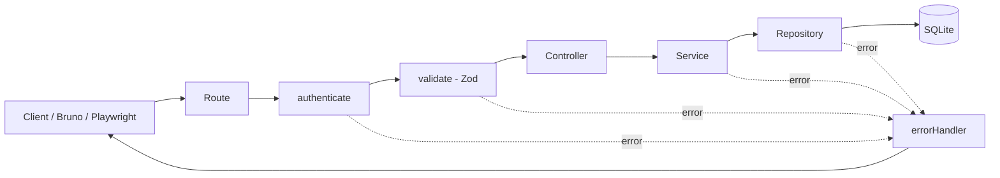
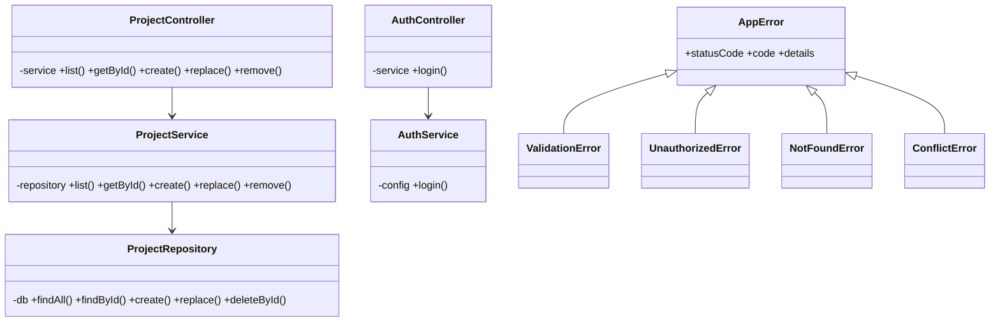
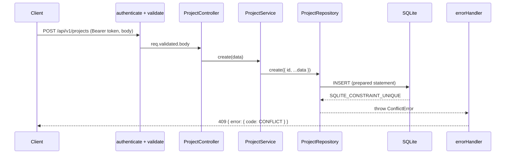

# Code structure (descriptive map — the rules are in `.agents/rules/architecture.md`)

## Request flow

## Classes

## Sequence: POST with a duplicate slug (409)

## Folder map

See `.agents/rules/project.md` (Folder layout). Wiring (composition root): `server/src/routes/index.js`
builds `db → ProjectRepository → ProjectService → ProjectController → routes`.

## Where does X live? (quick answers)

| Need | File |
|---|---|
| a new env var | `config/env.js` + `.env.example` |
| a new SQL query | `repositories/ProjectRepository.js` |
| a business rule (exists? generate id) | `services/ProjectService.js` |
| input validation | `models/project.schemas.js` |
| a new HTTP error | `errors/` + mapping in `rules/errors.md` |
