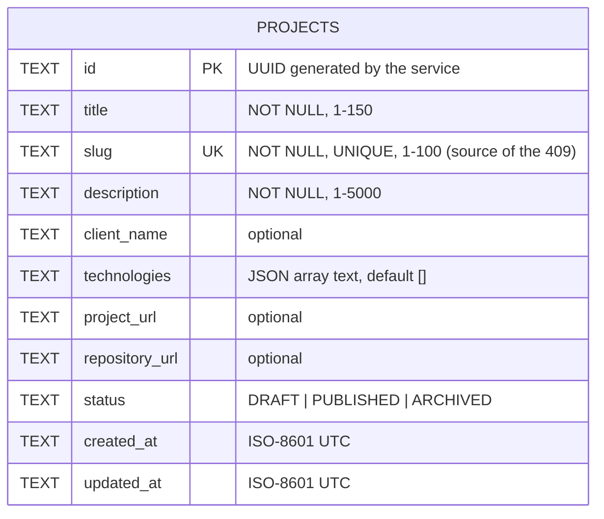

# Database structure (single source of truth)

Engine: SQLite (file `database/data/coys.sqlite`, git-ignored). One table for the MVP.

## ER diagram



## Migration `database/migrations/001_create_projects.sql` (copy exactly)

```sql
CREATE TABLE projects (
  id             TEXT PRIMARY KEY,
  title          TEXT NOT NULL CHECK (length(title) BETWEEN 1 AND 150),
  slug           TEXT NOT NULL UNIQUE CHECK (length(slug) BETWEEN 1 AND 100),
  description    TEXT NOT NULL CHECK (length(description) BETWEEN 1 AND 5000),
  client_name    TEXT CHECK (client_name IS NULL OR length(client_name) <= 150),
  technologies   TEXT NOT NULL DEFAULT '[]' CHECK (json_valid(technologies)),
  project_url    TEXT,
  repository_url TEXT,
  status         TEXT NOT NULL DEFAULT 'DRAFT' CHECK (status IN ('DRAFT','PUBLISHED','ARCHIVED')),
  created_at     TEXT NOT NULL DEFAULT (strftime('%Y-%m-%dT%H:%M:%fZ','now')),
  updated_at     TEXT NOT NULL DEFAULT (strftime('%Y-%m-%dT%H:%M:%fZ','now'))
);
CREATE INDEX idx_projects_status ON projects(status);
```

Why these rules live in the DB and not only in code: the DB guarantees them even under concurrent
requests or a bug in the API (defense answer for "why relational?").

## Seed `dev-data.sql` (fixed IDs — tests depend on them)

| id | slug | title | status | technologies |
|---|---|---|---|---|
| `00000000-0000-4000-8000-000000000001` | `portfolio-website` | Portfolio Website | PUBLISHED | `["Node.js","React"]` |
| `00000000-0000-4000-8000-000000000002` | `inventory-api` | Inventory API | PUBLISHED | `["Node.js","SQLite"]` |
| `00000000-0000-4000-8000-000000000003` | `mobile-booking-app` | Mobile Booking App | PUBLISHED | `["React Native"]` |
| `00000000-0000-4000-8000-000000000004` | `legacy-crm-migration` | Legacy CRM Migration | DRAFT | `[]` |
| `00000000-0000-4000-8000-000000000005` | `analytics-dashboard` | Analytics Dashboard | ARCHIVED | `["Python","SQL"]` |

Give each row a short description and an explicit `created_at`/`updated_at` (one day apart,
e.g. `2026-01-0X T10:00:00.000Z`) so ordering is deterministic. IDs are valid UUID v4 (version `4`,
variant `8`), which strict `z.uuid()` accepts.

**Non-existent but valid UUID for 404 tests:** `00000000-0000-4000-8000-0000000000ff`.
**Malformed id for 400 tests:** `not-a-uuid`.

## Seed `edge-cases.sql` (ids `…0101`–`…0105`, same prefix)

| id suffix | slug | What it exercises |
|---|---|---|
| `0101` | `accents-and-quotes` | accents, `ñ`, emoji-free unicode, single & double quotes in title/description |
| `0102` | `sql-injection-attempt` | title `'; DROP TABLE projects; --` stored literally (proves parameterization) |
| `0103` | `max-length-fields` | title 150 chars, description 5000 chars (`replace(hex(zeroblob(150)),'00','A')` builds N chars in SQLite) |
| `0104` | `empty-technologies` | `technologies = '[]'`, all optional fields `NULL` |
| `0105` | 100-char slug (`replace(hex(zeroblob(100)),'00','a')`) | slug length boundary |

## Provoking a 500 / empty state

`npm run db:break` drops the table (every DB-backed request → 500). `npm run db:reset -- --empty`
leaves the table with zero rows (list → 200 with `data: []`). `npm run db:reset` restores the normal state.
